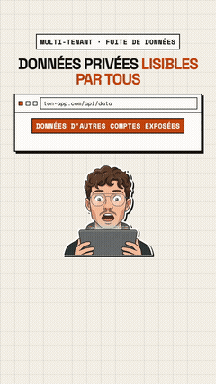
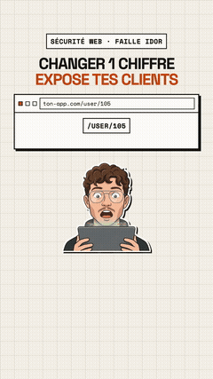

## Téo Brondel

Self-taught developer in France, studying for a BUT MMI. For about two and a half years I've built and shipped SaaS products end to end with Next.js, TypeScript, Supabase, PostgreSQL and Stripe.

Shipping fast with AI coding tools, I kept running into the same security failures: Row-Level Security that looks enabled but lets anyone read everything, secret keys bundled into the browser, API routes that never check who is asking. Finding and explaining those failures is what I work on now.

### Security work

- **[validra-check](https://github.com/Teo102/validra-check)** — open-source CLI that checks, from the outside and read-only, what a web app exposes to anyone: secret keys in client code, Supabase tables readable without logging in, public storage buckets. `npx validra-check <url>`
- **[Validra](https://validra.dev)** — focused security reviews of SaaS and web apps. Methodology and a [sample report](https://validra.dev/en/sample-report) are public.
- **[25 security mistakes AI coding tools still make](https://validra.dev/en/guide)** — free guide, with how to test for and fix each one.

### Products I've built

- **[EvacReport](https://evacreport.fr)** — B2B app for fire drill reports, built to work offline.
- **[MonBac](https://monbac.online)** — interactive AI coach to practice for oral exams.
- **[Portlio](https://portlio.co)** — client onboarding for freelancers, with Stripe payments.
- **[HelpToBack](https://helptoback.vercel.app)** — lost-and-found platform: protect your objects and reward whoever returns them.
- **[Expresso Poker Coach Hub](https://spin-craft-nu.vercel.app)** — training simulator for 3-max hyper-turbo poker, with a debrief of every decision.

### Security explainers (motion design)

I explain the vulnerabilities I find in short animated videos (in French). Click a preview to watch the full video.

| Cross-tenant data leak | Admin page with no auth | IDOR: change one digit |
|:---:|:---:|:---:|
|  |  |  |

More motion design work on my [portfolio](https://teobrondel.online) and [YouTube](https://www.youtube.com/@The_Life_Bomb).

### Contact

[validra.dev](https://validra.dev) · [teobrondel.online](https://teobrondel.online) · [LinkedIn](https://www.linkedin.com/in/t%C3%A9o-brondel-2051342aa)
